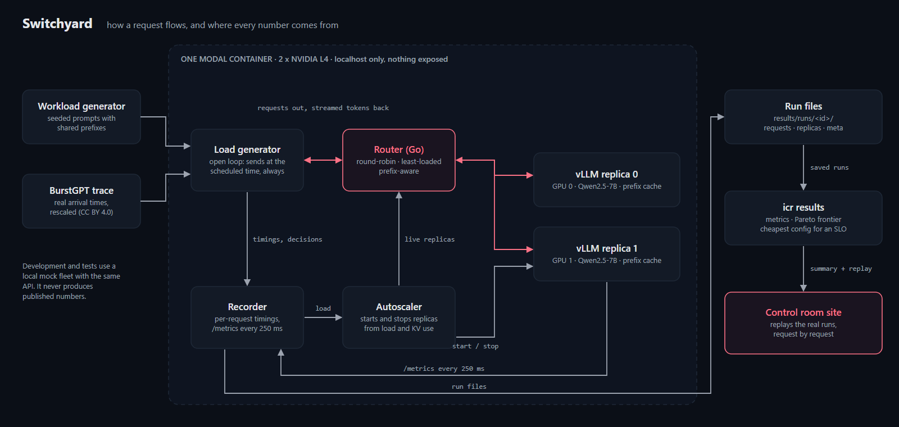
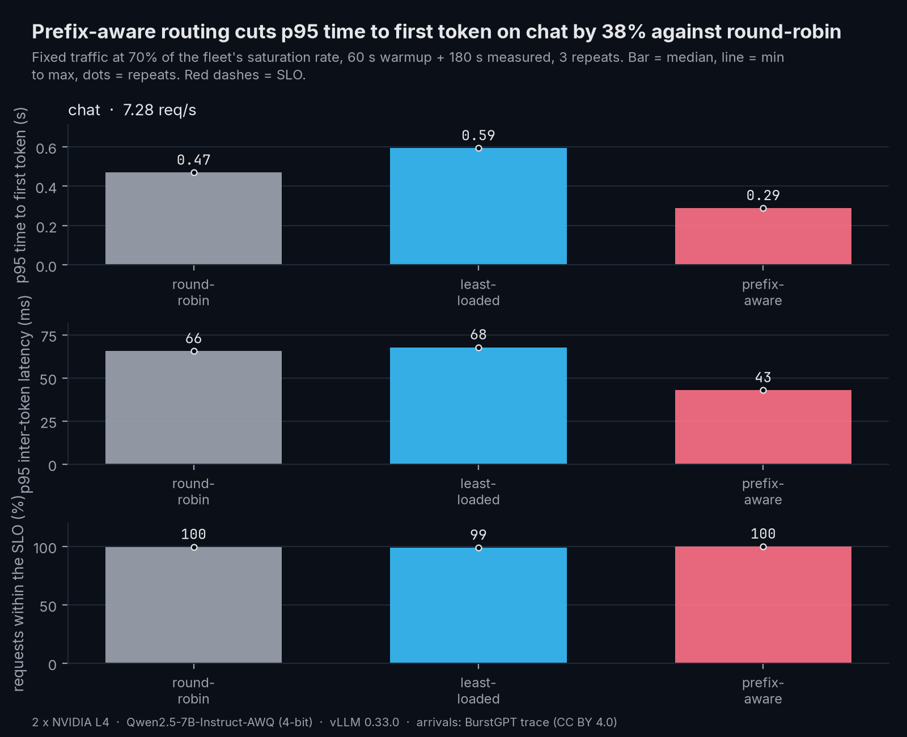
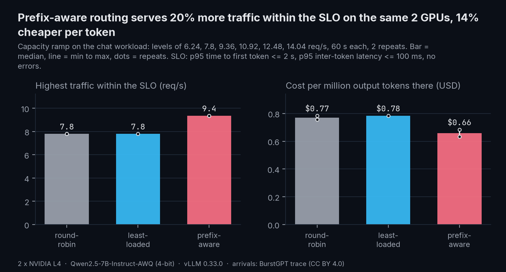
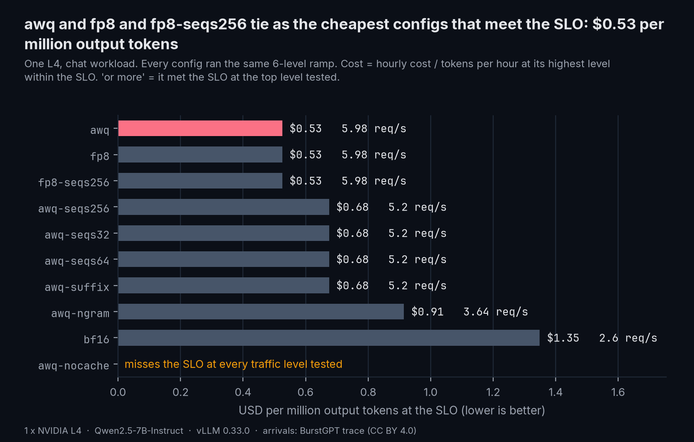
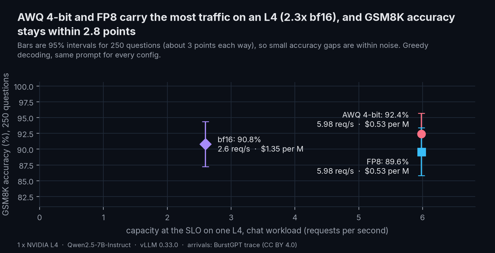
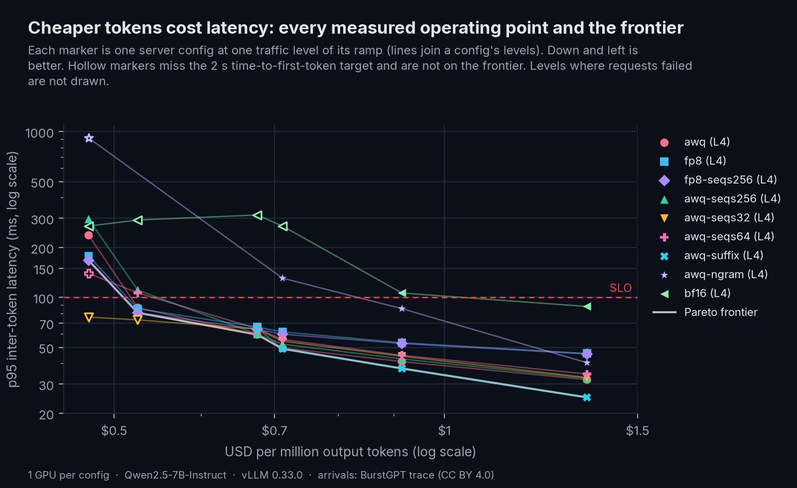
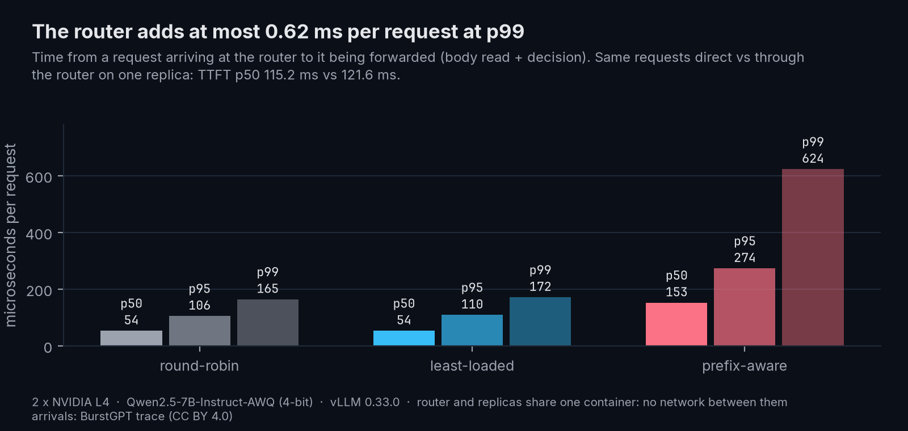

<p align="center">
  
</p>

<h1 align="center">Switchyard: Inference Control Room</h1>

<p align="center">
Serving LLMs is mostly a cost problem. Switchyard runs a small vLLM fleet on real traffic
patterns, measures which serving techniques lower cost and latency, and replays every
recorded request in an interactive control room.
</p>

<p align="center">
<b><a href="https://charlie-gzz.github.io/inference-control-room/">Open the live control room</a></b>
</p>


A longer cut: [assets/video/switchyard.mp4](assets/video/switchyard.mp4) (85 seconds, no sound).

## Headline

**On the same 2 GPUs and the same traffic, prefix-aware routing cut p95 time to first
token by 41% versus round-robin, and served 20% more traffic within the SLO, which is
14% lower cost per million tokens.**

| | round-robin | least-loaded | prefix-aware |
|---|---|---|---|
| p95 time to first token | 0.51 s | 0.59 s | **0.30 s** |
| p95 inter-token latency | 69 ms | 67 ms | **43 ms** |
| Prompt tokens served from cache | 74% | 74% | **84%** |
| Max traffic within the SLO | 7.8 req/s | 7.8 req/s | **9.36 req/s** |
| Cost per million output tokens at the SLO | $0.770 | $0.784 | **$0.659** |

Medians of 3 repeats (2 for the capacity rows) on 2 NVIDIA L4s with Qwen2.5-7B-Instruct
(4-bit AWQ) on vLLM 0.33.0. The capacity gap is one step of the traffic ramp, which is
also the ramp's resolution. Both repeats agree. Full tables with ranges are in
[results/RESULTS.md](results/RESULTS.md).

The plan was a 4-GPU fleet. Modal never scheduled a 4-GPU L4 container in five tries,
so these runs use the plan's fallback of 2 GPUs. See [Things that went wrong](#things-that-went-wrong).

## Quickstart

No GPU and no account needed. The recorded runs are in the repo.

```bash
uv sync
uv run icr site      # the control room, on http://127.0.0.1:8765
uv run icr results   # recompute every number from the saved runs
```

`uv run icr test` runs the tests (Python and Go) against a local mock fleet. Building the Go router
needs Go 1.27 on the path or in `.tools/go`.

## What is in here

- **A Go router** (standard library only) that proxies OpenAI-style streaming requests
  to vLLM replicas with three policies: round-robin, least-loaded and prefix-aware.
- **An open-loop load generator and recorder** that send each request at its scheduled
  time and record per-request timings, cached tokens and the router's decision.
- **A workload generator** with seeded chat, RAG, agentic and no-sharing mixes, driven
  by real arrival times from the BurstGPT trace.
- **An autoscaler** that starts and stops replicas inside the container.
- **A single-GPU config sweep** over quantization, speculative decoding, prefix caching
  and batch limits, with quality checks, on an L4 and on an H100.
- **An optimizer** that draws the cost and latency frontier and picks the cheapest
  config for a latency target.
- **The control room**: a static site that replays the recorded runs request by request.

## Architecture



Everything inside the dashed box runs in one Modal container on `localhost`. Nothing is
exposed to the internet, and no network sits between the router and the replicas.

## Results

### Routing: same traffic, three routers



Each policy got byte-identical requests at identical times. Round-robin and least-loaded
spread a conversation over both GPUs, so each GPU keeps recomputing prompts the other one
already has cached. Prefix-aware routing sends a follow-up to the GPU that served the
conversation before. It raised the share of prompt tokens served from cache from 74% to
84%, and that is where the latency gain comes from.

Least-loaded was no better than round-robin here. It was slightly worse on p95 time to
first token (0.59 s against 0.51 s).

### Capacity and cost



On identical traffic every policy burns the same GPU-seconds and produces the same
tokens, so the raw cost per token is the same by construction. A router lowers cost only
by letting the same GPUs carry more traffic before latency breaks. A stepped ramp finds
the highest rate that still meets the SLO. Cost per million tokens is the fleet's hourly
cost divided by the tokens per hour at that rate.

### Single-GPU configs



One L4, chat workload, one change at a time from the baseline (4-bit AWQ, prefix caching
on, no speculative decoding, default batch limit).

| Config | Max req/s at the SLO | $ per M output tokens | Note |
|---|---|---|---|
| `awq` (baseline) | 5.98 | 0.525 | GSM8K 92.4% |
| `fp8` | 5.98 | 0.525 | GSM8K 89.6%. A tie with AWQ. |
| `awq-seqs32`, `awq-seqs64`, `awq-seqs256` | 5.20 | 0.675 | One level down, which is within noise |
| `awq-suffix` | 5.20 | 0.675 | The engine crashed at the overload level |
| `awq-ngram` | 3.64 | 0.915 | 12.9% of proposed tokens accepted |
| `bf16` | 2.60 | 1.349 | GSM8K 90.8% |
| `awq-nocache` | missed the SLO at every level | | |

What this showed:

- **The baseline won.** No change beat 4-bit AWQ with prefix caching on.
- **Prefix caching is the big lever.** With it off, the same GPU missed the SLO even at
  the lowest traffic level.
- **Speculative decoding made things worse** on this workload. Outputs are short
  (median 36 tokens) and prompts are long (1,260 tokens on average), so most of the
  GPU's work is reading prompts, and speculation spends extra work per step.
- **bf16 is less than half as fast on an L4.** The weights leave little room for the
  KV cache (74,000 tokens against 250,000 for AWQ), so cached prefixes get evicted.
- **Inter-token latency sets the limit**, not time to first token. vLLM admits requests
  into the running batch as they arrive, so first tokens stay quick while every step
  gets slower.





### A bigger GPU: one H100

The four configs that matter most ran again on one H100, with traffic levels calibrated
on the H100 itself.

| Config | Max req/s at the SLO | $ per M output tokens | p95 token gap there |
|---|---|---|---|
| `awq` | 54.4 | 0.242 | 17 ms |
| `bf16` | 54.4 | 0.242 | 12 ms |
| `fp8` | 54.4 | 0.242 | 11 ms |
| `awq-ngram` | 54.4 | 0.242 | 34 ms |

- **Nine times the traffic for four times the price.** One vLLM replica on an H100
  carried 54.4 req/s within the SLO, against 5.98 on an L4. The H100 container costs
  4.1 times as much per hour. That is $0.242 per million output tokens against $0.525,
  or 54% lower, if there is enough traffic to fill it.
- **Quantization stopped mattering.** bf16, FP8 and 4-bit AWQ reached the same level.
  With 80 GB of memory the full-precision weights leave plenty of room for the cache.
- **The limit changed character.** On the L4 the gap between tokens broke the SLO first.
  On the H100 the token gap stayed under 20 ms, and at 64 req/s requests queued for
  seconds before their first token.
- **Speculative decoding still did not help.** N-gram lookup tied on capacity and
  doubled the token gap.
- **What set the limit is not known.** All four configs broke at the same level, which
  points away from the GPU's arithmetic and toward the work around it. The runs cannot
  tell the two apart, so this is reported as the limit of one vLLM replica, not of the
  GPU.

The frontier chart above shows both GPUs.

### Router overhead



The prefix-aware decision takes 153 microseconds at the median and 624 at p99. The same
60 requests sent directly and through the router differed by 6.4 ms of median time to
first token.

## How it works

1. **Workloads.** `icr.workloads` builds seeded request sequences. A chat session resends
   its history every turn, so turn 5 shares a long prefix with turn 4. Arrival times come
   from the BurstGPT trace, compressed in time to the target rate.
2. **Load.** The load generator sends each request at its scheduled time whether or not
   earlier ones have finished. Latency counts from the scheduled time.
3. **Routing.** The router hashes the prompt text in 256-byte chunks and remembers which
   replica it sent each prefix to. A new request goes to the replica with the longest
   match, unless that replica is over its load bound. Then it goes to the least loaded
   one. Every decision is logged with its reason.
4. **Serving.** One vLLM process per GPU, each with its own prefix cache.
5. **Recording.** Per-request timings and the router's decisions go to
   `results/runs/<run_id>/`, with replica metrics sampled every 250 ms.
6. **Analysis.** `icr results` recomputes every metric from the saved runs.
   `icr assets` redraws every chart and rebuilds the site data.
7. **Replay.** The control room animates the recorded requests. Click a request to see
   its real record: when it was scheduled, where it went and why, and how long it took.

## Method

- **Open-loop load.** A closed-loop client slows down with the server and hides the
  queue. Here the schedule never waits.
- **Identical traffic.** Within a repeat, every policy gets the same request bodies at
  the same times. Output lengths are fixed per request, so every policy generates the
  same number of tokens.
- **Frozen before results.** The SLO, workloads, load levels, windows, repeats and seeds
  were written down in [docs/DECISIONS.md](docs/DECISIONS.md) before the runs they apply
  to. Decisions made after seeing data are marked as such there.
- **Calibrated load.** Traffic levels are multiples of a measured single-GPU saturation
  rate, not picked by hand.
- **Clean state.** Every run starts with empty prefix caches and an empty router table.
  Policies are interleaved inside a session so drift cannot favor one.
- **Repeats.** 3 per fleet comparison, 2 for the capacity ramp. Tables show the median
  with min and max and flag any spread above 10%.
- **Cost at the SLO.** See [Capacity and cost](#capacity-and-cost).
- **SLO.** p95 time to first token of 2.0 s or less, p95 inter-token latency of 100 ms
  or less, and no failed requests.
- **Measured against modeled.** Everything on this page is measured. Autoscaling savings
  are modeled and labeled as modeled wherever they appear.

[docs/DESIGN_FAQ.md](docs/DESIGN_FAQ.md) answers the questions an expert would ask, with
pointers to the code.

## Things that went wrong

- **The 4-GPU container never started.** Five requests for 4 L4s in one container, on
  three days and at five different hours, waited 50 to 80 minutes each and were
  cancelled. Nothing was billed. One L4 was available within 20 minutes on the same
  afternoon. The fleet ran on 2 GPUs, the plan's fallback. Even 2 GPUs in one container
  took up to two hours of queue, and one request never started at all. With 2 replicas, round-robin lands a follow-up on the
  right GPU half the time (a quarter of the time with 4), so the routing effect measured
  here is probably smaller than on 4 GPUs.
- **Draft-model speculative decoding could not run.** vLLM requires the draft and the
  target to have the same vocabulary size. Qwen2.5-0.5B has 151,936 entries and
  Qwen2.5-7B has 152,064.
- **Suffix decoding crashed the engine** during the overload level of its ramp. The run
  is kept as a result.
- **The first cost estimate was wrong.** It used wall-clock time, which included 7
  minutes in the queue that Modal does not bill. The ledger now reads Modal's billing
  report per run.
- **One calibration ramp started hot on an empty cache** and missed the SLO at its
  first level, then passed the next four. The rule for that case was added after seeing
  it, and it picks the lower of the two candidate values.
- **Capacity near the limit is noisy.** Of four AWQ ramps near 6 req/s, one met the
  inter-token target and three missed it by 0.2 to 11 ms. One-level differences between
  configs are reported as ties. The H100 showed the same thing: a calibration ramp met
  the SLO at 64 req/s, and every sweep ramp missed it there.
- **The first H100 ramp was far too low.** The planned levels (8 to 48 req/s) all met
  the SLO with room to spare, so the ramp had to be extended upwards by a rule written
  down before running it.
- **A ramp that starts hot looks worse than it is.** The extended H100 ramp began at
  64 req/s on an empty cache and missed the SLO there. A ramp that climbed to 64 passed.

## Limitations

- **2 GPUs, not 4.** See above.
- **Fleet runs that were never made.** Only the chat comparison and the capacity ramp
  ran on the fleet. The rag workload, the no-sharing control and the autoscaling
  comparison did not: on the last day, four requests for a 2-GPU container waited up to
  two hours each without starting. So there is no measured answer here to "where does
  prefix-aware routing gain nothing", and the autoscaler is tested only against the
  local mock fleet. One of the six capacity ramp runs (the second least-loaded repeat)
  is also missing. The commands to add them are in [docs/HANDOFF.md](docs/HANDOFF.md).
- **One model family, and one GPU type for the fleet.** Qwen2.5-7B on NVIDIA L4, plus a
  single-GPU sweep on one H100. Other models and GPUs will have different limits.
- **The H100 limit is not attributed.** The runs do not show whether the GPU or the
  CPU-side work of vLLM set it, and no quality check was rerun on the H100.
- **Synthetic prompt text.** Arrival times and response lengths are real (BurstGPT).
  Prompt text is generated, with prefix sharing set by the workload description.
- **Forced output lengths.** Requests use greedy decoding with `ignore_eos`, so every
  policy generates the same tokens. Real traffic stops when the model stops.
- **Short runs.** Minutes, not hours. Slow effects such as cache churn over a day are
  not measured.
- **No network.** The router and replicas share one container. A real fleet adds
  network latency and failures.
- **The router guesses.** It tracks what it sent to each replica, not what the replica
  still has cached.
- **Capacity resolution.** A ramp finds capacity to within one level (15% on one GPU,
  20% on the fleet).
- **Small quality sample.** GSM8K uses 250 questions, so accuracy is known to about 3
  points each way. The gaps between quantizations are inside that.
- **One router process.** No shared state, health checks or retries.

## Cost to reproduce

$10.11 in total: $2.84 for the L4 sweeps, $3.21 for the fleet and $4.06 for the H100
session. Every run is in [docs/GPU_LEDGER.md](docs/GPU_LEDGER.md) with its billed cost,
including the requests that waited in the queue and never started ($0).

Replaying and recomputing the saved results costs nothing.

## Attributions

- **BurstGPT** arrival trace, CC BY 4.0. Wang et al., "BurstGPT: A Real-World Workload
  Dataset to Optimize LLM Serving Systems", KDD 2025.
  [github.com/HPMLL/BurstGPT](https://github.com/HPMLL/BurstGPT). Only arrival times and
  response lengths are used.
- **Qwen2.5** models, Apache-2.0, official `Qwen/` uploads.
- **GSM8K**, MIT.
- **vLLM**, Apache-2.0.

Full list with pinned revisions: [THIRD_PARTY.md](THIRD_PARTY.md).

## License

MIT. See [LICENSE](LICENSE).
